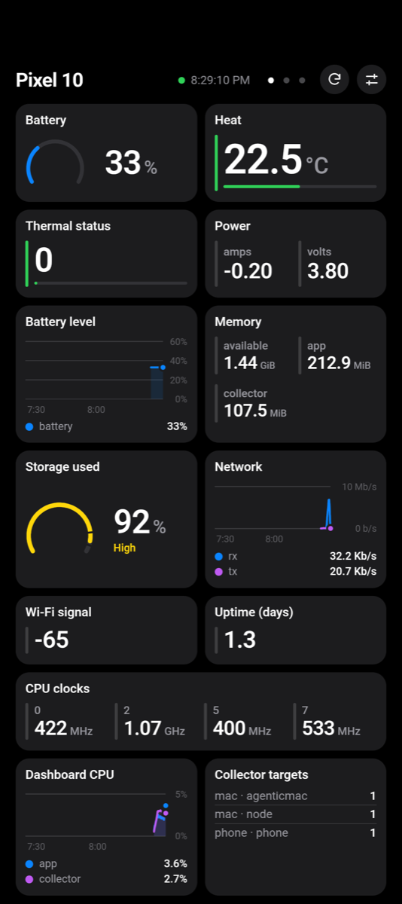
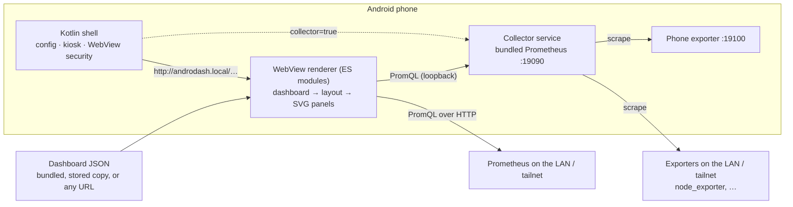

# AndroDash

Turn an Android phone into an always-on Prometheus dashboard.

AndroDash is a kiosk app that renders [Perses](https://perses.dev/) dashboards
**on the phone**, in a locked-down WebView, and queries **Prometheus directly**.
It needs no dashboard server, screenshot service, or proxy. It can also run its
own Prometheus on the phone, so a dashboard keeps working when your laptop is
asleep or away.

<p align="center">
  
  
  
</p>
<p align="center">
  
  
  
</p>

<sub>From left: fit-to-screen layout · the bundled phone dashboard on a Pixel 10
· double-tap zoom · grayscale lock-screen view · the settings sheet · scroll
layout. All but the Pixel shot use the deterministic mock Prometheus in this
repository.</sub>

## Features

- **Perses subset, rendered on the phone.** Time series, stat, gauge, table,
  and Markdown panels drawn as hand-built SVG by a plain ES-module renderer. It
  has no build step and no runtime dependencies.
- **Fit to screen.** Every panel fits on one screen and the layout re-plans on
  rotation. Numbers stay legible: charts give up height first, and anything that
  still does not fit scrolls.
- **Several dashboards.** Swipe sideways between up to 8 dashboards, or rotate
  through them on a timer. Double-tap a panel to zoom it; double-tap again to
  return.
- **Prometheus on the phone (optional).** The APK bundles the upstream
  Prometheus binary, with a pinned SHA-256. It runs as a foreground service that
  scrapes your exporters and serves the dashboard on loopback.
- **Phone metrics built in.** An in-app exporter reports battery, thermal,
  memory, storage, network, Wi-Fi, CPU clocks, and the app's own CPU and memory.
  A bundled phone dashboard shows them.
- **Made for a wall or a nightstand.** Kiosk mode, true-black `amoled` and
  `monochrome` palettes, and a dimmed grayscale view above the lock screen.
  Back and accidental swipes never leave the app.
- **Honest.** A missing sample stays missing and is never drawn as zero. Panels
  the client cannot serve are hidden, and the reason is recorded in the
  diagnostics.

## Try it in a browser (1 minute)

You need Python 3.10 or newer.

```sh
python3 tools/mock_prometheus.py --port 9091   # terminal 1: synthetic metrics
python3 tools/serve_demo.py --port 8099        # terminal 2: serves this repository
```

Open
<http://localhost:8099/web/app/index.html?dashboard_url=http://localhost:8099/contracts/fixtures/spark-dashboard.json&prometheus_url=http://localhost:9091&layout_mode=fit>.
Use the browser's device toolbar for a phone-sized viewport.

## Put it on a phone

To build the debug APK you need JDK 17+, the Android SDK (platform 35), and adb.
`mise install` provides the pinned JDK, Node, Python, and Gradle.

```sh
mise exec -- ./gradlew :app:assembleDebug     # first build downloads Prometheus once
adb install -r app/build/outputs/apk/debug/app-debug.apk
adb shell am start -n com.mbicz.androdash/.MainActivity \
  --es dashboard_url "http://androdash.local/dashboards/phone-dashboard.json" \
  --ez collector true
```

This launch shows the phone's own metrics without any other machine. To point
it at your Prometheus, or to scrape your exporters from the phone, see
**[Getting started](docs/getting-started.md)**.

## How it works



The shell parses the launch configuration, serves the bundled renderer from a
virtual origin, and applies kiosk behaviour. Everything about dashboards
(fetching, layout, queries, drawing) lives in the renderer and is described by
contracts. Read the [architecture overview](docs/architecture/overview.md) for
the full picture.

## Bundled dashboards

| Dashboard | Data | Notes |
|---|---|---|
| `phone-dashboard.json` | in-app phone exporter | Battery, heat, power, memory, storage, network, Wi-Fi, CPU clocks, collector targets. [Details](docs/integrations/phone-exporter.md) |
| `macos-node-dashboard.json` | node_exporter on macOS | CPU, memory, disk, network, load, free space. [Setup](docs/getting-started.md#4-show-a-macs-metrics) |
| `agenticmac-exporter` (`agenticmac-dashboard.json`) | [agenticmac-exporter](docs/integrations/agenticmac-exporter.md) | AI coding agents: sessions, tokens/s, spend, quota, model speed. |
| `spark-dashboard.json` | Spark Exporter (DGX Spark) | GPU, unified memory, inference, RDMA. [Details](docs/integrations/spark-exporter.md) |
| `demo-dashboard.json` | mock Prometheus | Exercises every supported and unsupported panel kind. |

They are served at `http://androdash.local/dashboards/<file>`. You can also use
any Perses dashboard JSON over HTTP(S). To stay renderable it must use only the
[supported subset](docs/contracts/C-005-panel-rendering.md#supported-panels).

## Documentation

| Read | For |
|---|---|
| [Getting started](docs/getting-started.md) | Install, connect Prometheus, run the collector, choose dashboards, gestures, troubleshooting |
| [Architecture overview](docs/architecture/overview.md) | Components, data flow, deployment shapes, failure behaviour |
| [Renderer](docs/architecture/renderer.md) · [Android shell](docs/architecture/android-shell.md) · [Security](docs/architecture/security.md) · [Testing](docs/architecture/testing.md) | How each part is built |
| [Contracts C-001…C-009](docs/contracts/README.md) | Every launch option, supported panel, error code, and bridge method |
| [Decision log](changelog.d/README.md#decision-index) | Why it is built this way (21 decisions) |
| [Development guide](docs/development.md) | Every command: tests, emulator, debugging |
| [Documentation map](docs/index.md) | Everything else |

## Repository layout

```
app/          Android shell (Kotlin): config, WebView, kiosk, collector, phone exporter
web/app/      renderer (vanilla ES modules, SVG); web/tests/ contract tests
tools/        mock Prometheus, static demo server, dashboard generators, docs checker
contracts/    JSON Schemas and fixtures; fixtures/*-dashboard.json ship in the APK
docs/         getting started, architecture, contracts, integrations, roadmap
changelog.d/  decision log
```

## Development

```sh
mise exec -- node --test web/tests/                          # renderer tests
python3 -m unittest discover -s tools -p 'test_*.py'         # tooling tests
mise exec -- ./gradlew :app:testDebugUnitTest :app:lintDebug # Android tests + lint
python3 tools/check_docs.py                                  # local Markdown links
```

The project is contract-first. A change to an interface (a launch option, panel
behaviour, error code, or bridge method) updates its contract in
`docs/contracts/` and adds a `changelog.d/` entry. [`AGENTS.md`](AGENTS.md) is
the entry point for contributors and coding agents, and
[`CONSTITUTION.md`](CONSTITUTION.md) lists the principles that do not bend.

## Status

AndroDash runs daily on a Pixel 10 against a Mac's node_exporter and
agenticmac-exporter, with the collector on the phone. The current milestone is
M3 (soak testing, accessibility, reconnect behaviour); see the
[roadmap](docs/roadmap.md). Only a debug APK is built today. Release signing,
Prometheus authentication, and alerting are not implemented.

## Third-party software

The APK bundles the unmodified upstream
[Prometheus](https://github.com/prometheus/prometheus) linux-arm64 binary
(Apache License 2.0). Its `LICENSE` and `NOTICE` ship in the APK under
`assets/licenses/prometheus/`.
