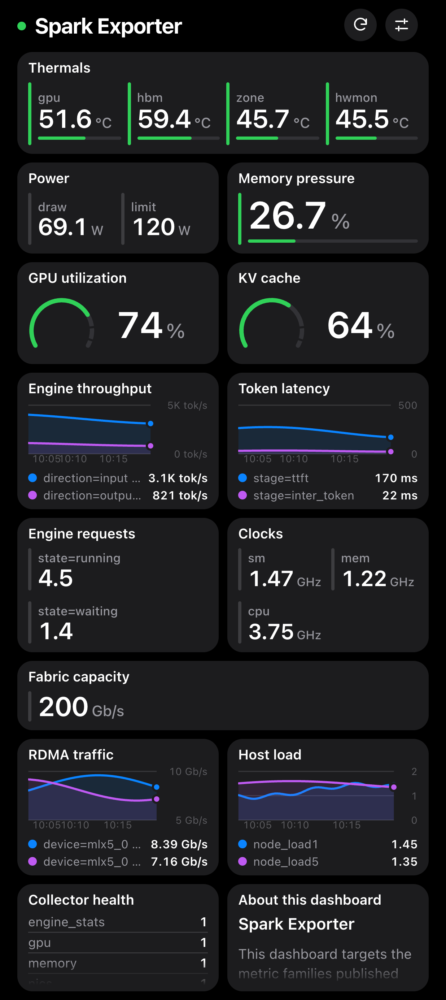
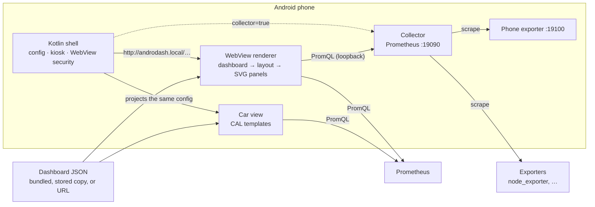

# AndroDash

AndroDash turns an Android phone into a dashboard. It renders
[Perses](https://perses.dev/) dashboards on the phone's screen, queries
Prometheus directly, and can run a small Prometheus on the phone itself. The same
dashboard can also be projected to an Android Auto or Android Automotive car
screen as a glanceable summary.

<p align="center">
  
</p>

<sub>Spark dashboard in `fit` layout. More: [lock screen](docs/images/locked.png),
[settings](docs/images/settings.png), [zoom](docs/images/zoom.png),
[scroll layout](docs/images/scroll.png), [desktop](docs/images/desktop.png).</sub>

## Surfaces

| Surface | What it does | Details |
|---|---|---|
| Phone (WebView) | Full dashboard: panels, layouts, zoom, multiple dashboards, kiosk and lock-screen modes | [Getting started](docs/getting-started.md), [renderer](docs/architecture/renderer.md) |
| On-phone collector | Bundled Prometheus (SHA-256 pinned) on `127.0.0.1:19090`, run as a foreground service | [Phone exporter](docs/integrations/phone-exporter.md), [C-001](docs/contracts/C-001-launch-config.md) |
| Car view | Android Auto (IOT category) and Android Automotive OS: a tabbed summary of the same data, built from Car App Library templates | [Car view](docs/integrations/car-view.md), [C-010](docs/contracts/C-010-car-projection.md) |

### Phone

- Panels: time series, stat, gauge, table, and Markdown. They are drawn as SVG by
  plain ES modules, with no build step and no runtime dependencies.
- Layouts: `fit` puts every panel on one screen; `grid` and `stack` scroll.
  Panels scroll internally, and a double tap zooms a panel to full screen.
- Up to 8 dashboards. Swipe between them or rotate on a timer. Add a dashboard by
  URL, or paste its JSON, from the settings sheet.
- Ignition: one JSON document seeds dashboards and collector targets at launch.
  One-shot mode applies it once and deletes the source file. `ignition_wait`
  instead polls a provisioning server every `ignition_wait_seconds`, so a phone
  can be provisioned without knowing its address, and keeps polling after an
  apply.
- Built-in phone exporter: device, battery, thermal, memory, storage, network,
  Wi-Fi, CPU, screen, and process usage, including the collector's own.
- Kiosk mode, `amoled` and `monochrome` palettes, and an optional dimmed view above
  the lock screen.
- A missing sample is shown as missing, never as zero. A panel the client cannot
  serve is hidden, and the reason is recorded in diagnostics.

### Car view

- A **summary**, not the phone renderer at another size. Car App Library (CAL)
  gives an IoT-category app templates only: no chart template and no drawing
  surface.
- Each panel becomes a row: a tinted state dot, a label, a fixed-width block bar
  (percent panels) or block sparkline (other numeric series), and `value · state`.
- Severity comes from which threshold a value crossed, honouring the dashboard's
  `thresholds.polarity` (`high-is-bad` or `high-is-good`). It is not keyed on
  threshold names.
- Panels the car cannot show (Markdown) are counted and reported, not dropped
  silently. A missing query renders `No data`, never a zero.
- Refresh is floored at 10 seconds. Rows are sized to the host's
  `ConstraintManager` limits, not to the phone's metrics.
- Verified on the Android Automotive OS emulator; the Desktop Head Unit procedure
  is documented. It is not yet installed in a real car. Real-car access needs a
  Play Console listing and review. A sideloaded CAL app shows in the Desktop Head
  Unit but not in a car launcher.

## Requirements

- An arm64 Android phone running Android 10 (API 29) or later. `minSdk` is 29
  because `androidx.car.app:app-automotive` requires it (decision 0033).
- To build: JDK 21, Android SDK platform 35, and adb. `mise install` provides the
  versions pinned in `.mise.toml`.

## Quick start

Browser, with mock data (Python 3.10+):

```sh
python3 tools/mock_prometheus.py --port 9091
python3 tools/serve_demo.py --port 8099
open "http://localhost:8099/web/app/index.html?dashboard_url=http://localhost:8099/contracts/fixtures/spark-dashboard.json&prometheus_url=http://localhost:9091&layout_mode=fit"
```

Phone, showing its own metrics through the on-phone collector:

```sh
mise exec -- ./gradlew :app:assembleDebug
adb install -r app/build/outputs/apk/debug/app-debug.apk
adb shell am start -n com.mbicz.androdash/.MainActivity \
  --es dashboard_url "http://androdash.local/dashboards/phone-dashboard.json" \
  --ez collector true
```

Car view on the Android Automotive OS emulator, with setup, user-10 seeding, and
capture steps: [Car view → Verification](docs/integrations/car-view.md#verification).

To connect Prometheus, add exporters, choose dashboards, and troubleshoot, see
[Getting started](docs/getting-started.md).

## How it works



The shell parses launch options, serves the bundled renderer from a virtual
origin, applies kiosk behaviour, and hosts the car service. The phone renderer
does fetching, layout, queries, and drawing. The car view projects the normalised
dashboard into rows with its own pure-Kotlin projector (C-010). See the
[architecture overview](docs/architecture/overview.md).

## Bundled dashboards

Served at `http://androdash.local/dashboards/<file>`:

| File | Data source |
|---|---|
| `phone-dashboard.json` | In-app [phone exporter](docs/integrations/phone-exporter.md) |
| `macos-node-dashboard.json` | node_exporter on macOS |
| `agenticmac-dashboard.json` | [agenticmac-exporter](docs/integrations/agenticmac-exporter.md) (AI coding agents on a Mac) |
| `spark-dashboard.json` | [Spark Exporter](docs/integrations/spark-exporter.md) (DGX Spark) |
| `inference-fleet-dashboard.json` | Inference fleet: hosts, engines, and tokens per second ([decision 0032](changelog.d/0032-inference-fleet-dashboard.md)) |
| `demo-dashboard.json` | Mock Prometheus; covers every supported and unsupported panel kind |

Any Perses dashboard JSON reachable over HTTP(S) also works, provided it stays
within the [supported subset](docs/contracts/C-005-panel-rendering.md#supported-panels);
add it from the settings sheet. Pasted JSON is stored on the phone.

## Documentation

| Document | Contents |
|---|---|
| [Getting started](docs/getting-started.md) | Install, connect Prometheus, collector, dashboards, gestures, troubleshooting |
| [Car view](docs/integrations/car-view.md) | What the car screen shows, its geometry, and how to verify it |
| [Architecture overview](docs/architecture/overview.md) | Components, data flow, deployment shapes, failure behaviour |
| [Renderer](docs/architecture/renderer.md), [Android shell](docs/architecture/android-shell.md), [Security](docs/architecture/security.md), [Testing](docs/architecture/testing.md) | Component internals |
| [Contracts C-001…C-010](docs/contracts/README.md) | Launch options, panels, errors, bridge, car projection |
| [Decision index](changelog.d/README.md#decision-index) | Why each design choice was made |
| [Roadmap](docs/roadmap.md) | Milestones and open work |
| [Development guide](docs/development.md) | Tests, emulator, debugging |
| [Documentation map](docs/index.md) | Everything else |

## Repository layout

```
app/          Android shell (Kotlin): config, WebView, kiosk, collector, phone exporter, car view
web/app/      renderer (ES modules, SVG); web/tests/ contract tests
tools/        mock Prometheus, static server, dashboard generators, discovery, provisioning, docs checker
contracts/    JSON Schemas and fixtures; fixtures/*-dashboard.json are bundled in the APK
docs/         getting started, architecture, contracts, integrations, roadmap
changelog.d/  decision log
```

## Development

```sh
mise exec -- node --test web/tests/
python3 -m unittest discover -s tools -p 'test_*.py'
mise exec -- ./gradlew :app:testDebugUnitTest :app:lintDebug
python3 tools/check_docs.py
```

Interface changes (launch options, panel behaviour, error codes, bridge methods,
car projection rules) update the contract in `docs/contracts/` and add a
`changelog.d/` entry. See [`AGENTS.md`](AGENTS.md) and
[`CONSTITUTION.md`](CONSTITUTION.md).

## Limitations

- Only debug APKs are built and installed so far. The release build type has no
  signing config, and nothing is published to a store.
- No authentication to Prometheus or exporters; use a trusted LAN or tailnet.
- No alerting and no dashboard editing.
- The car view has no charts, only text sparklines and block bars, and at most
  two text lines per row.
- Open items are listed in the [roadmap](docs/roadmap.md).

## Third-party software

The APK bundles the unmodified upstream
[Prometheus](https://github.com/prometheus/prometheus) linux-arm64 binary
(Apache License 2.0). The build downloads the pinned release and checks its
SHA-256 (`app/build.gradle.kts`). Its `LICENSE` and `NOTICE` are packaged as
`licenses/prometheus/` in the APK assets.
