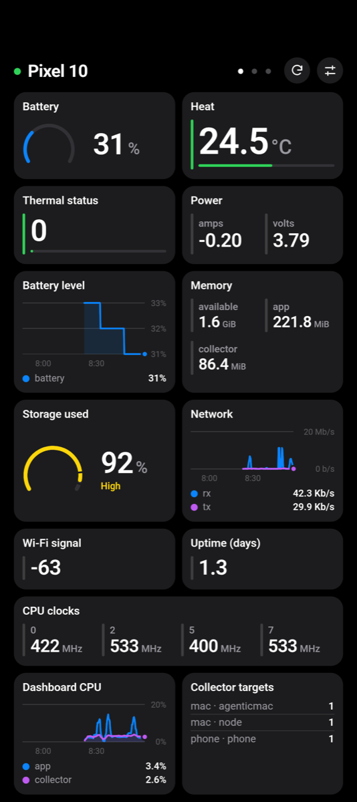
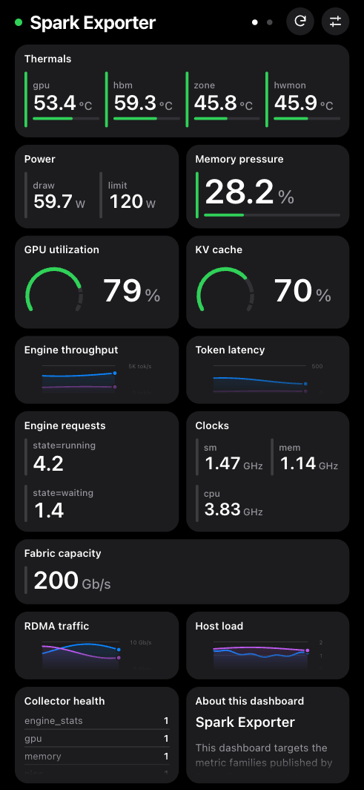
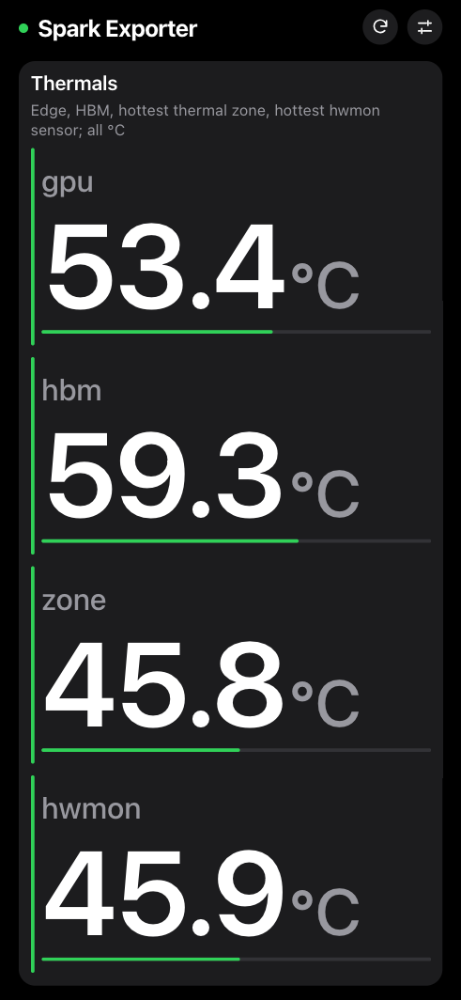
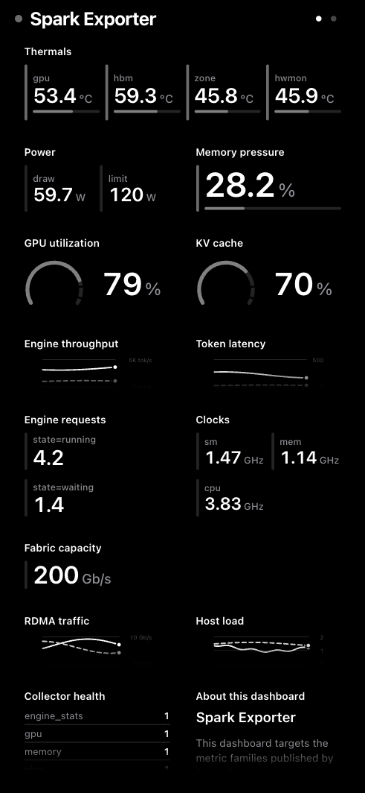
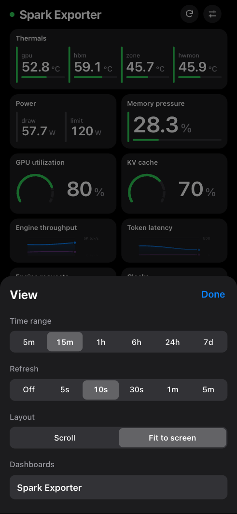
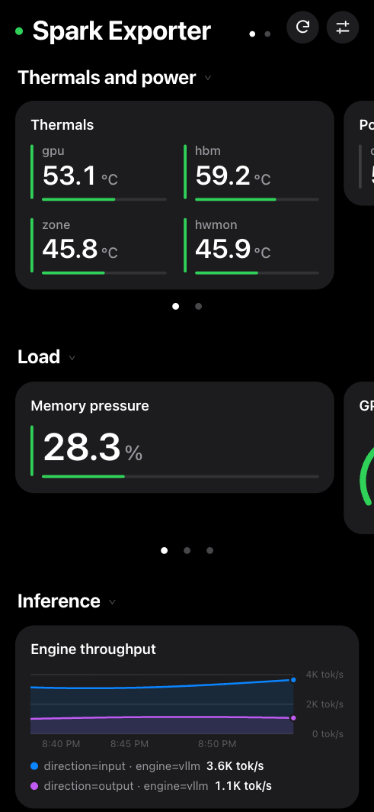
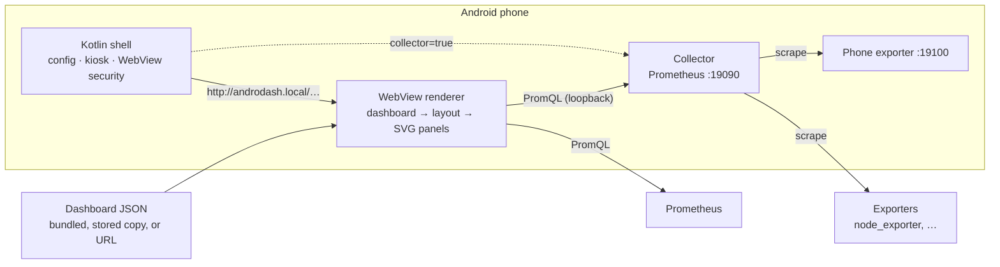

# AndroDash

An Android kiosk app that renders [Perses](https://perses.dev/) dashboards on
the phone and queries Prometheus directly. It can also run Prometheus on the
phone itself.

<p align="center">
  
  
  
</p>
<p align="center">
  
  
  
</p>

<sub>Phone dashboard on a device; the others use the mock Prometheus in
`tools/`.</sub>

## Features

- Panels: time series, stat, gauge, table, Markdown. They are drawn as SVG by
  plain ES modules, with no build step and no runtime dependencies.
- Layouts: `fit` puts every panel on one screen; `grid` and `stack` scroll.
  Panels scroll internally, and a double tap zooms a panel to full screen.
- Up to 8 dashboards. Swipe between them or rotate on a timer.
- Optional on-phone collector: the APK bundles the upstream Prometheus binary
  (SHA-256 pinned). It runs as a foreground service on `127.0.0.1:19090` and
  scrapes your exporters.
- Built-in phone exporter: battery, thermal, memory, storage, network, Wi-Fi,
  CPU clocks, and the app's own CPU and memory.
- Kiosk mode, `amoled` and `monochrome` palettes, and an optional dimmed view
  above the lock screen.
- Missing samples are shown as missing, never as zero. Panels the client cannot
  serve are hidden, and the reason is recorded in diagnostics.

## Requirements

- An arm64 Android phone running Android 8.0 (API 26) or later.
- To build: JDK 17+, Android SDK platform 35, and adb. `mise install` provides
  the toolchain pinned in `.mise.toml`.

## Quick start

Browser, with mock data (Python 3.10+):

```sh
python3 tools/mock_prometheus.py --port 9091
python3 tools/serve_demo.py --port 8099
open "http://localhost:8099/web/app/index.html?dashboard_url=http://localhost:8099/contracts/fixtures/spark-dashboard.json&prometheus_url=http://localhost:9091&layout_mode=fit"
```

Phone, showing its own metrics:

```sh
mise exec -- ./gradlew :app:assembleDebug
adb install -r app/build/outputs/apk/debug/app-debug.apk
adb shell am start -n com.mbicz.androdash/.MainActivity \
  --es dashboard_url "http://androdash.local/dashboards/phone-dashboard.json" \
  --ez collector true
```

To connect Prometheus, add exporters, choose dashboards, and troubleshoot, see
[Getting started](docs/getting-started.md).

## How it works



The shell parses launch options, serves the bundled renderer from a virtual
origin, and applies kiosk behaviour. Fetching, layout, queries, and drawing all
happen in the renderer. See the [architecture overview](docs/architecture/overview.md).

## Bundled dashboards

Served at `http://androdash.local/dashboards/<file>`:

| File | Data source |
|---|---|
| `phone-dashboard.json` | In-app [phone exporter](docs/integrations/phone-exporter.md) |
| `macos-node-dashboard.json` | node_exporter on macOS |
| `agenticmac-dashboard.json` | [agenticmac-exporter](docs/integrations/agenticmac-exporter.md) (AI coding agents on a Mac) |
| `spark-dashboard.json` | [Spark Exporter](docs/integrations/spark-exporter.md) (DGX Spark) |
| `demo-dashboard.json` | Mock Prometheus; covers every supported and unsupported panel kind |

Any Perses dashboard JSON reachable over HTTP(S) also works, provided it stays
within the [supported subset](docs/contracts/C-005-panel-rendering.md#supported-panels).

## Documentation

| Document | Contents |
|---|---|
| [Getting started](docs/getting-started.md) | Install, connect Prometheus, collector, dashboards, gestures, troubleshooting |
| [Architecture overview](docs/architecture/overview.md) | Components, data flow, deployment shapes, failure behaviour |
| [Renderer](docs/architecture/renderer.md), [Android shell](docs/architecture/android-shell.md), [Security](docs/architecture/security.md), [Testing](docs/architecture/testing.md) | Component internals |
| [Contracts C-001…C-009](docs/contracts/README.md) | Launch options, panels, errors, bridge |
| [Decision index](changelog.d/README.md#decision-index) | Why each design choice was made |
| [Development guide](docs/development.md) | Tests, emulator, debugging |
| [Documentation map](docs/index.md) | Everything else |

## Repository layout

```
app/          Android shell (Kotlin): config, WebView, kiosk, collector, phone exporter
web/app/      renderer (ES modules, SVG); web/tests/ contract tests
tools/        mock Prometheus, static server, dashboard generators, docs checker
contracts/    JSON Schemas and fixtures; fixtures/*-dashboard.json are bundled in the APK
docs/         getting started, architecture, contracts, integrations, roadmap
changelog.d/  decision log
```

## Development

```sh
mise exec -- node --test web/tests/
python3 -m unittest discover -s tools -p 'test_*.py'
mise exec -- ./gradlew :app:testDebugUnitTest :app:lintDebug
python3 tools/check_docs.py
```

Interface changes (launch options, panel behaviour, error codes, bridge methods)
update the contract in `docs/contracts/` and add a `changelog.d/` entry. See
[`AGENTS.md`](AGENTS.md) and [`CONSTITUTION.md`](CONSTITUTION.md).

## Limitations

- Only debug builds; no release signing.
- No authentication to Prometheus or exporters; use a trusted LAN or tailnet.
- No alerting and no dashboard editing.
- Open items are listed in the [roadmap](docs/roadmap.md).

## Third-party software

The APK bundles the unmodified upstream
[Prometheus](https://github.com/prometheus/prometheus) linux-arm64 binary
(Apache License 2.0). Its `LICENSE` and `NOTICE` ship under
`assets/licenses/prometheus/`.
