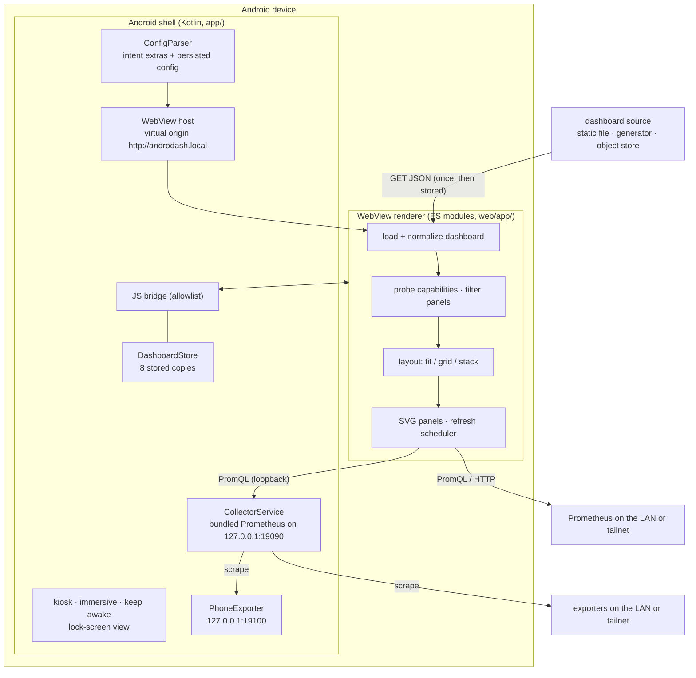

# Architecture overview

**Status:** implemented (M1/M2 plus the M3 work to date: on-device dashboards,
on-phone collector, phone exporter, multiple dashboards). This document
describes the components that exist, not a future target. Remaining M3 items
are in [`../roadmap.md`](../roadmap.md).
**Audience:** every workstream.
**Contracts:** C-001 … C-009.

## 1. Context

AndroDash is a single-purpose Android appliance:

- **Input:** one or more URLs of Perses dashboard JSON documents (bundled in
  the APK, kept as a stored copy, or fetched), plus a way to reach a
  Prometheus datasource.
- **Output:** a full-screen, auto-refreshing dashboard rendered by the phone.
- **Constraint:** no application server is required to execute the dashboard.
  The phone can even be its own Prometheus (the collector).

The dashboard definition may be static, generated by a build pipeline, or
generated on demand from the client's advertised capabilities. AndroDash accepts
the JSON; it does not generate it.



## 2. Goals

- Render the supported Perses subset in a WebView on the phone.
- Fetch metrics directly from Prometheus from the WebView.
- Refresh periodically without overlapping work.
- Advertise capabilities and filter panels the client cannot serve.
- Run in kiosk mode with honest status and diagnostics.
- Keep the boot path and refresh path bounded and testable.
- Let parallel, know-nothing agents work from contracts and fixtures.

## 3. Non-goals (v1)

- Full Perses UI parity, dashboard editing, or a Perses server replacement.
- Server-side rendering or a required backend proxy.
- Grafana migration.
- Authentication flows, secrets management, or multi-tenant access.
- Tempo/Loki/OpenTelemetry panels; they are filtered, not rendered.
- Dashboard editing on the phone, playlists beyond `dashboard_urls`, or
  interaction beyond paging, folding, scrolling inside panels, and zoom.
- Alerting, annotations, or long-term storage.
- Native Android chart widgets or Compose UI.

## 4. Components

| Component | Responsibility | Must not do |
|---|---|---|
| Android shell (`app/`) | Parse/validate launch config, build the local URL, configure a locked-down WebView, apply kiosk behavior, expose a minimal bridge | Parse dashboards, run PromQL, draw charts |
| Web runtime (`web/app/`) | Config parsing, dashboard fetch/normalize, capability probe, variable resolution, query scheduling, layout, rendering, diagnostics | Require a bundler, load remote code, access Android APIs beyond the bridge |
| Collector (`app/`, `CollectorService`) | Run the bundled upstream Prometheus on loopback, scrape configured exporters, supervise and restart it (decision 0019) | Expose admin/remote-write APIs, listen beyond loopback, start at boot |
| Phone exporter (`app/`, `PhoneExporter`) | Serve the phone's own readings in Prometheus text format on `127.0.0.1:19100` for the collector (decision 0021) | Report a reading it could not take; listen beyond loopback |
| Demo tooling (`tools/`) | Deterministic mock Prometheus and static file serving for browser/emulator demos | Be required in production |
| Contracts (`contracts/`, `docs/contracts/`) | Machine-readable schemas, fixtures, and interface invariants | Drift from code |
| Decision log (`changelog.d/`) | Record why material choices were made | Be rewritten after acceptance |

## 5. End-to-end flow

### Boot

1. Android parses Intent extras and persisted config (C-001).
2. It validates URLs and builds
   `http://androdash.local/index.html?dashboard_url=…&prometheus_url=…`.
3. The shell serves bundled assets for the virtual origin, then applies kiosk,
   keep-awake, and WebView security settings (decision 0007, C-007, C-008).
4. The renderer parses the same query parameters (defense in depth).
5. The renderer fetches and normalizes the dashboard (C-002).
6. It probes datasources and computes the advertised capability set (C-004).
7. It resolves variables (C-002), filters panels (C-004), and renders the layout
   (C-005).
8. It starts the first data refresh (C-006).

Failure at any stage produces a visible, coded state (C-009). The renderer never
falls back to fabricated data.

### Refresh tick

1. Capture one `end` time and derive `start` from the time range (C-006).
2. Each visible data panel issues its queries against the same time window.
3. Responses are normalized (C-003) and panels update independently.
4. A panel failure keeps its last good data, marks it stale, and records an
   error; other panels continue.
5. When the cycle settles, schedule the next cycle `refreshSeconds` later.
6. Never overlap cycles. Pause while the page is hidden; refresh immediately on
   return if stale.

### Capability negotiation

The renderer builds a capability set at boot:

- v1 supports `prometheus`; `tempo`, `loki`, and `opentelemetry` are recognized
  but not implemented.
- A panel is eligible only if its panel plugin, every query plugin, its
  datasource, and the required capabilities are supported and healthy.
- Ineligible panels are hidden and counted. With `show_unsupported=true`, they
  become explicit placeholders.
- Diagnostics expose the advertised set, probe results, hidden panels, and
  reasons.

This is the seam a dashboard generator uses: target the advertised capability
IDs, then let the client filter defensively.

## 6. Deployment topologies

### A. Emulator/demo (M2)

```
host: mock Prometheus :9091
host: static server :8099
emulator: APK → 10.0.2.2:8099 / 10.0.2.2:9091
```

### B. Home LAN appliance

```
phone ──Wi-Fi──► Prometheus :9090
phone ──HTTP(S)──► dashboard JSON (NAS, object store, static host)
```

No server-side rendering component.

### C. Self-contained phone (collector)

```
phone: bundled Prometheus :19090 ──scrape──► phone exporter :19100
                                  ──scrape──► LAN/tailnet exporters (node_exporter :9100, …)
renderer ──loopback──► :19090
dashboards: bundled in the APK or stored copies
```

Nothing but exporters runs elsewhere. History lives on the phone
(`collector_retention`, default 24 h).

### D. Generated dashboards

A generator publishes dashboard JSON tailored to a capability set. The phone
fetches it and filters again. A future feature may let the generator read the
capability document directly; v1 does not add a callback endpoint.

## 7. Failure modes and required behavior

| Failure | Required behavior |
|---|---|
| Missing/invalid launch config | Native error screen with `E_CONFIG`; no WebView |
| Dashboard URL unreachable or CORS-blocked | Renderer fatal card `E_DASHBOARD_FETCH` with an origin/CORS hint; retry via debug/reload |
| Dashboard is not a Perses dashboard | Fatal card `E_DASHBOARD_PARSE` with a short reason |
| Dashboard exceeds limits | Fatal card `E_DASHBOARD_LIMIT` |
| No Prometheus reachable | Markdown panels render; data panels hidden; banner/diagnostics explain `prometheus` unavailable |
| CORS blocked | Panel error `E_PROM_NETWORK` with an actionable CORS hint; others continue |
| Query error | Panel error `E_PROM_QUERY`; keep last good data if any |
| Unsupported panel/query | Hidden (or placeholder with `show_unsupported=true`) and counted |
| WebView crash | Shell reloads the local page with the same config; log the event |
| Network loss | Visible stale state; retry on the next cycle; no blank screen if last data exists |
| Device reboot | Persisted config relaunches the kiosk (subject to Android startup policy) |

## 8. Security and trust boundaries

- The dashboard JSON and all strings in it are untrusted.
- Prometheus responses are untrusted.
- The shell trusts only the local bundled renderer.
- The bridge exposes a tiny allowlist of methods; the WebView cannot navigate
  away or load remote code.
- Cleartext HTTP is allowed for LAN metrics; see C-008 and decision 0006.
- Diagnostics redact query strings and credentials.

See [`security.md`](security.md) for the full model.

## 9. Performance model

- One WebView and one refresh scheduler; only the dashboard on screen is
  loaded and queried, even with several in `dashboard_urls`.
- Measured on one phone (decision 0019): the collector uses about 2 % of one core and 35–100
  MiB RSS, and writes about 3 MiB of disk per hour.
- Bounded panels, series, and points (C-003/C-005).
- SVG line charts for v1; no charting dependency.
- Layout is built once; refreshes update panel bodies, not the whole DOM.
- No overlapping refresh cycles; hidden tabs do not query.
- Targets: first paint under ~2 s on the emulator with the demo, typical refresh
  under ~1 s with mock data, and stable memory over hours.

Measurements and test recipes are in [`testing.md`](testing.md).

## 10. Evolution

The contracts are designed to allow:

- new capability IDs and panel/query plugins;
- additional datasource kinds;
- a native capability document consumed by generators;
- optional HTTPS/auth for Prometheus;

without changing the shell/renderer boundary. Any such change needs a decision
entry and contract updates.
