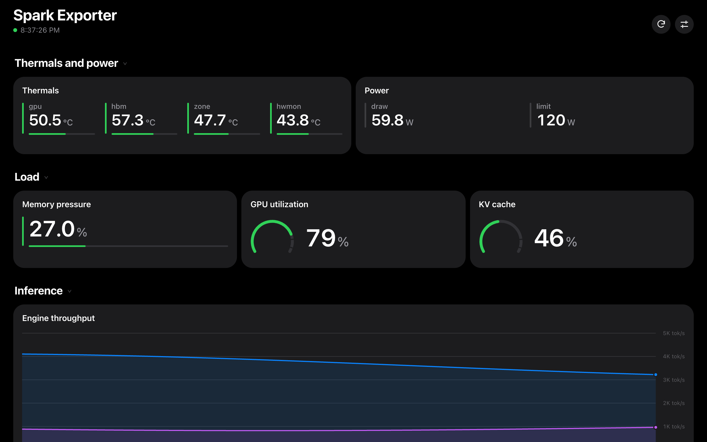

# Getting started

All options: [C-001 Launch configuration](contracts/C-001-launch-config.md).
All development commands: [`development.md`](development.md).

1. [Browser](#1-browser)
2. [Build and install](#2-build-and-install)
3. [First launch](#3-first-launch)
4. [Add a computer's metrics](#4-add-a-computers-metrics)
5. [Dashboards and display options](#5-dashboards-and-display-options)
6. [Gestures and status](#6-gestures-and-status)
7. [Custom dashboards](#7-custom-dashboards)
8. [Seed a device with Ignition](#8-seed-a-device-with-ignition)
9. [Troubleshooting](#9-troubleshooting)

## 1. Browser

```sh
python3 tools/mock_prometheus.py --port 9091
python3 tools/serve_demo.py --port 8099
```

| Dashboard | URL |
|---|---|
| Spark Exporter, fit layout | <http://localhost:8099/web/app/index.html?dashboard_url=http://localhost:8099/contracts/fixtures/spark-dashboard.json&prometheus_url=http://localhost:9091&layout_mode=fit> |
| Demo, diagnostics overlay | <http://localhost:8099/web/app/index.html?dashboard_url=http://localhost:8099/contracts/fixtures/demo-dashboard.json&prometheus_url=http://localhost:9091&debug=true> |

Launch options are query parameters in the browser and intent extras on the
phone.



## 2. Build and install

| Requirement | Notes |
|---|---|
| Phone | arm64, Android 8.0+, USB or wireless debugging enabled |
| Toolchain | JDK 17+, Android SDK platform 35, adb; `mise install` provides the pinned versions |
| Disk | ~1 GB: the first build downloads the pinned Prometheus release (~100 MB) to `~/.gradle/androdash-cache/`; `app/build` reaches ~600 MB |

```sh
mise exec -- ./gradlew :app:assembleDebug
adb devices
adb install -r app/build/outputs/apk/debug/app-debug.apk
```

With several devices, or with wireless debugging, add `-s <serial>` to each
`adb` command.

## 3. First launch

The app needs one launch with extras. It persists the configuration and
restores it from the launcher icon, after a reboot, or after a crash.

```sh
adb shell am start -n com.mbicz.androdash/.MainActivity \
  --es dashboard_url "http://androdash.local/dashboards/phone-dashboard.json" \
  --ez collector true \
  --es layout_mode fit
```

- `http://androdash.local/dashboards/…` is a dashboard bundled in the APK.
- `collector=true` runs the bundled Prometheus as a foreground service on
  `127.0.0.1:19090`, and the renderer queries it there. The service holds a
  partial wake lock, so keep the phone on a charger.
- By default the collector scrapes the in-app phone exporter
  (`127.0.0.1:19100`, job `phone`).
- History starts empty. Charts fill as scrapes arrive, every 15 s by default.

Result: the title is the phone's model name, the panels show data, and
"Collector targets" lists `phone · phone` = `1`.

## 4. Add a computer's metrics

Run node_exporter on the computer, listening on all interfaces. On macOS:

```sh
brew install node_exporter
echo '--web.listen-address=0.0.0.0:9100' > "$(brew --prefix)/etc/node_exporter.args"
brew services start node_exporter
```

### Option A: the phone scrapes the exporter

```sh
adb shell am start -n com.mbicz.androdash/.MainActivity \
  --es dashboard_urls "http://androdash.local/dashboards/macos-node-dashboard.json,http://androdash.local/dashboards/phone-dashboard.json" \
  --ez collector true \
  --es collector_targets "node:mac=192.168.1.20:9100" \
  --es layout_mode fit
```

`collector_targets` is a comma-separated list of up to 32
`[job:]instance=host:port` entries. The bundled dashboards expect these jobs:
`node` for node_exporter, `agenticmac` for
[agenticmac-exporter](integrations/agenticmac-exporter.md), and `phone`, which
is added automatically. History is kept on the phone (`collector_retention`,
default `24h`).

### Option B: the phone queries an existing Prometheus

```sh
adb shell am start -n com.mbicz.androdash/.MainActivity \
  --es dashboard_url "http://androdash.local/dashboards/macos-node-dashboard.json" \
  --es prometheus_url "http://192.168.1.20:9090"
```

Prometheus must listen beyond loopback (`--web.listen-address=0.0.0.0:9090`).
Its default `--web.cors.origin=.*` already allows `http://androdash.local`.

### Over Tailscale

Exporters bound to `0.0.0.0` are also reachable on the tailnet. Use the host's
tailnet address (`tailscale ip -4`) or MagicDNS name in `collector_targets` or
`prometheus_url`. While the phone's active network is the VPN, the phone
exporter reads Wi-Fi signal from the underlying Wi-Fi network.

Prometheus and the exporters are unauthenticated in this setup; expose them
only on a trusted LAN or tailnet
([decision 0006](../changelog.d/0006-cleartext-lan-http.md),
[C-008](contracts/C-008-webview-security.md)).

## 5. Dashboards and display options

Everything below can also be changed on the phone. The settings sheet (sliders
icon) has:

- **Time range**, **Refresh**, **Layout**.
- **Dashboards**: tap to show, Remove, add a bundled one, **Add from URL** (the
  dashboard is fetched and checked first, and the reason is shown if it cannot
  be added), **Paste dashboard JSON** (kept on the phone), and Rotate.
- **Collector**: On/Off, the scrape targets with Remove, and **Add target**
  (address `host:port`, optional job and name). The phone target is fixed.
- **On the lock screen**.

Changes apply at once and persist. Typing is only needed for URLs, JSON, and
target addresses; launch extras still work.


| Option | Example | Effect |
|---|---|---|
| `dashboard_urls` | `--es dashboard_urls "<url>,<url>"` | Up to 8 dashboards; swipe between them; also editable in the sheet |
| `rotate_seconds` | `--ei rotate_seconds 60` | Advance automatically; `0` = off, else 10–3600 |
| `layout_mode` | `--es layout_mode fit` | `fit` (one screen), `auto`, `grid`, `stack` |
| `display_mode` | `--es display_mode amoled` | `standard`, `amoled` (true black), `monochrome` |
| `show_when_locked` | `--ez show_when_locked true` | Dimmed dashboard above the keyguard; `lock_style` `monochrome` or `color` |
| `time_range`, `refresh_seconds` | `--es time_range 1h --ei refresh_seconds 30` | Override dashboard defaults |
| `dashboard_source` | `--es dashboard_source url` | `stored` (default) keeps a copy of a remote dashboard; `url` fetches on every load |
| `collector`, `collector_targets` | `--ez collector true --es collector_targets "node:mac=192.168.1.20:9100"` | On-phone Prometheus and its scrape targets; also editable in the sheet |

The sheet adds remote dashboard URLs and pasted dashboards on your behalf. It
never takes them from dashboard or Prometheus content, so a dashboard cannot
point the kiosk somewhere else by itself.

## 6. Gestures and status

| Input | Action |
|---|---|
| Horizontal swipe | Next or previous dashboard; anywhere in `fit`, on the header in scroll layouts |
| Vertical drag on a panel | Scrolls that panel |
| Double tap on a panel | Zooms it to full screen; double tap again to return |
| Tap a row title (scroll layouts) | Folds the row |
| Back | Ignored in kiosk mode |

The dot before the title shows data freshness: green fresh, amber stale or
partly failing, red offline, gray loading. Panels show the same state on their
left edge. With `--ez debug true` the diagnostics overlay shows the last update
time and per-panel errors.

To leave kiosk mode, relaunch with `--ez kiosk false` (Back then exits), or run
`adb shell am force-stop com.mbicz.androdash`. `--ez collector false` stops the
collector, and the renderer goes back to the configured `prometheus_url`.

## 7. Custom dashboards

Requirements for a Perses dashboard JSON:

- panels: `TimeSeriesChart`, `StatChart`, `GaugeChart`, `Table`, `Markdown`
  ([C-005](contracts/C-005-panel-rendering.md#supported-panels));
- queries: Prometheus time-series queries; dashboard variables are supported
  ([C-002](contracts/C-002-dashboard-source.md),
  [C-004](contracts/C-004-capability-negotiation.md));
- served with CORS that allows `http://androdash.local` (or `*`).
  `tools/serve_demo.py --host <lan-ip>` serves this repository that way.

Add it in the settings sheet (**Add from URL**) or in `dashboard_urls`. After
the first successful load the phone keeps a copy, so the server is no longer
needed. **Paste dashboard JSON** stores the definition on the phone and needs
no server at all.

### The demo dashboard

`demo-dashboard.json` uses the mock metrics in `tools/mock_prometheus.py`. To
show it on a phone, run the mock on a computer and add it as a collector
target, then add the dashboard by URL (or paste it):

```sh
python3 tools/mock_prometheus.py --host 0.0.0.0 --port 9091
python3 tools/serve_demo.py --host 0.0.0.0 --port 8099
```

In the settings sheet, add the target `demo:demo=<computer>:9091` (the mock
serves `/metrics` for scraping) and the dashboard
`http://<computer>:8099/contracts/fixtures/demo-dashboard.json`. The bundled
`demo-dashboard.json` shows the same panels once the target is added.

To bundle a dashboard, add `contracts/fixtures/<name>-dashboard.json` and
rebuild. It is then served at
`http://androdash.local/dashboards/<name>-dashboard.json` and listed in the
settings sheet. The bundled dashboards come from generators such as
[`tools/gen_phone_dashboard.py`](../tools/gen_phone_dashboard.py).

## 8. Seed a device with Ignition

One JSON document can set the dashboards, the collector, and its targets at
launch, then remove itself ([C-001 Ignition](contracts/C-001-launch-config.md#ignition)).
Every key is optional and an absent key keeps the current value:

```json
{
  "schemaVersion": 1,
  "dashboards": {
    "urls": [
      "http://androdash.local/dashboards/phone-dashboard.json",
      "http://192.168.1.20:8099/contracts/fixtures/spark-dashboard.json"
    ]
  },
  "collector": {
    "enabled": true,
    "targets": "node:mac=192.168.1.20:9100,demo:demo=192.168.1.20:9091"
  },
  "layoutMode": "fit"
}
```

Two sources:

```sh
# A. from a URL on the LAN or tailnet
adb shell am start -n com.mbicz.androdash/.MainActivity \
  --es ignition_url "http://192.168.1.20:8099/ignition.json"

# B. a file on the device (debug build; applied on the next launch)
adb push ignition.json /data/local/tmp/ignition.json
adb shell run-as com.mbicz.androdash sh -c 'cat /data/local/tmp/ignition.json > files/ignition.json'
adb shell am start -n com.mbicz.androdash/.MainActivity
```

`dashboards.inline` carries dashboard objects instead of URLs, so a device can be
seeded with no dashboard server at all. After a successful apply the file is
deleted and the `ignition_url` extra is dropped, so the device keeps whatever is
changed in the app afterwards. An invalid document shows `E_IGNITION` (or
`E_IGNITION_FETCH` for a failed fetch) instead of the dashboard.

### Generate the document from the network

`tools/discover_hosts.py` probes the documented exporter ports, reads `/metrics`
to decide what each host runs, and writes the document
([decision 0026](../changelog.d/0026-exporter-discovery.md)):

```sh
python3 tools/discover_hosts.py --prometheus http://192.168.1.20:9090 \
  --device <adb serial> --ignition /tmp/ignition.json
cp /tmp/ignition.json . && python3 tools/serve_demo.py --host 0.0.0.0 --port 8099
adb shell am start -n com.mbicz.androdash/.MainActivity \
  --es ignition_url "http://192.168.1.20:8099/ignition.json"
```

It always seeds the bundled phone dashboard first, then one dashboard per
discovered exporter, and enables the collector with canonical targets:

| Port | Exporter | Dashboard | Instance label |
|---:|---|---|---|
| 9100 | node_exporter on macOS | `macos-node-dashboard.json` | `node_uname_info{nodename}` |
| 9106 | agenticmac-exporter | `agenticmac-dashboard.json` | same, else reverse DNS |
| 9091 | demo/mock Prometheus | `demo-dashboard.json` | same |
| 9400 | spark-exporter | `spark-dashboard.json` | same |

A host is listed only when its `/metrics` proves it: the macOS dashboard needs
`sysname="Darwin"`, the others need their own metric family. Candidates come
from `--host`, a Prometheus's active targets, the ARP table, and
`tailscale status`; loopback targets are dropped. With `--device` (and `--adb`
for a non-default adb server) every candidate is re-probed from the phone, so a
target the Mac can reach but the phone cannot is dropped instead of seeded as a
permanent `0`. The document is validated against the shell's rules before it is
written.

### Provision a phone by its own code

A phone launched with `ignition_wait` shows a six-digit device code and keeps
asking a provisioning server for its document until one exists
([decision 0027](../changelog.d/0027-device-code-provisioning.md)). Nothing has
to know the phone's serial number or address first.

```sh
# 1. Serve the repository, including the provisioning directory.
python3 tools/serve_demo.py --host 0.0.0.0 --port 8099

# 2. Launch the phone with the templated URL. It shows its code and waits.
adb shell am start -n com.mbicz.androdash/.MainActivity \
  --es ignition_url "http://192.168.1.20:8099/ignition/{device}.json" \
  --ez ignition_wait true

# 3. Read the code off the screen (or from the request log), then provision it.
python3 tools/provision.py pending
python3 tools/provision.py write 482913 /tmp/ignition.json
```

The phone applies the document within `ignition_wait_seconds` (default 15,
`--ei ignition_wait_seconds 5` to poll faster). Polling **continues** after the
document applies ([decision 0028](../changelog.d/0028-continuous-provisioning.md)),
so writing a new `<code>.json` re-provisions a running phone within one interval,
with no relaunch; an identical document is a no-op. That also means a poll
overwrites in-app edits — `--ez ignition_wait false` clears the template, stops
polling, and returns the phone to one-shot seeding. A document that does not
parse is still `E_IGNITION`.

The code and the request log live in `provisioning/` at the repository root:

| Command | Effect |
|---|---|
| `python3 tools/provision.py pending` | Codes that polled and have no document, newest first |
| `python3 tools/provision.py served` | Codes that already have a document |
| `python3 tools/provision.py write <code> <file>` | Validate and store `<code>.json` |
| `python3 tools/provision.py show <code>` | Print the stored document |
| `python3 tools/provision.py clear <code>` | Delete it, so the phone waits again |

`serve_demo.py` answers `/ignition/<code>.json`; a missing file is a plain 404,
which is exactly what the phone treats as "not provisioned yet". The shell also
appends `device_code`, `device_model`, and `device_ip` to the URL, so a server
can key on any of them without templating. The code is not a credential: the
convention is unauthenticated and belongs on a trusted LAN.

## 9. Troubleshooting

| Symptom | Check |
|---|---|
| Native `E_CONFIG` screen | No extras on first launch, or an invalid value; the screen names the field |
| Native `E_IGNITION` screen | The Ignition document is invalid; the screen names the key. Fix the file/URL and tap Retry |
| Native `E_IGNITION_FETCH` screen | The phone cannot fetch `ignition_url` (scheme, status, size, timeout), or the URL has an unknown `{token}`, a fragment, or is too long |
| Provisioning screen never leaves "not provisioned" | `python3 tools/provision.py pending` lists the codes the server saw; write `<code>.json` for the code shown on the phone. Check the phone can reach the server host and port |
| Device code differs from the one on the server | The code is per-installation: read it off the screen or from `adb shell run-as com.mbicz.androdash cat shared_prefs/androdash.xml` |
| `E_DASHBOARD_FETCH` | The phone cannot reach the URL, or the server lacks CORS. Try a bundled dashboard |
| Panel shows "No data" | Check the query's job in `up`, or in the "Collector targets" panel. The exporter must listen on `0.0.0.0` |
| Collector target is `0` | The phone cannot reach `host:port`: firewall, Wi-Fi isolation, or VLAN |
| Empty charts after launch | Collector history starts empty; wait a few scrape intervals |
| Other | `--ez debug true` and `adb logcat -s AndroDash` |

More: [`development.md` § Troubleshooting](development.md#10-troubleshooting)
and the [collector inspection commands](development.md#prometheus-on-the-phone-collector).
